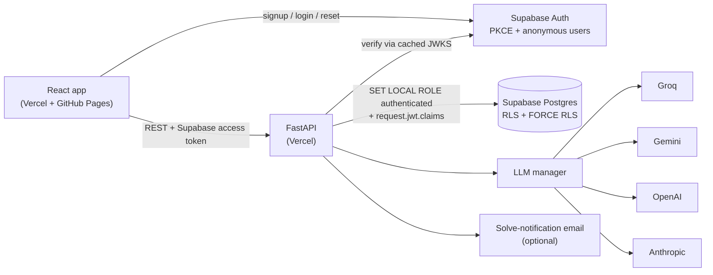

# CodeMentor AI

> **Code generators give you answers. CodeMentor AI builds your understanding.**

CodeMentor AI is a Socratic programming mentor. Paste a broken function and it
never shows you the fix: it asks one guiding question at a time, challenges
your reasoning, works within a budget of 3 hints per session, and closes the
session only after you explain the fix in your own words.

## Live URLs

| What | URL |
|------|-----|
| Frontend (Vercel, production) | <https://codementor-ai.vercel.app> |
| Backend API (Vercel) | <https://codementor-ai-api.vercel.app> |
| Frontend (GitHub Pages, public mirror) | <https://astroelaa.github.io/codementor-ai/> |
| API health | <https://codementor-ai-api.vercel.app/health> |
| API readiness (checks the real DB) | <https://codementor-ai-api.vercel.app/ready> |

## Architecture



- Supabase Auth owns signup, login, logout, password reset email, and anonymous
  guest identities. The frontend uses the Supabase JS client with PKCE and
  persists the session locally.
- The backend accepts only Supabase access tokens. It verifies the signature
  against the project's cached JWKS and checks `exp`, issuer, audience
  `authenticated`, and role `authenticated`. It never trusts a token without
  those checks.
- The backend is the only writer for app data. The frontend uses Supabase only
  for auth, never for table queries.
- Every backend request applies the authenticated role and JWT claims to its
  database transaction with `SET LOCAL ROLE authenticated` plus
  `request.jwt.claims`. Public endpoints run as `anon`. Explicit ownership
  filters remain in the query layer as defense in depth.
- `DELETE /api/auth/me` deletes the Supabase Auth user through the service-role
  Admin API, then removes the local profile. That is the only use of the
  service-role key.

1. The student opens a debugging session and presses Diagnose.
2. The backend builds a Socratic prompt and calls the configured LLM provider,
   falling back to the next configured provider on error or rate limit.
3. The model diagnoses the bug internally and returns one guiding question plus
   structured feedback (understanding score, misconception tag, next topics).
4. Hints cost 1 of 3 per session, enforced server-side. Explanations are scored;
   a passing explanation marks the session solved and earns badges.

## Repository layout

```
.
├── frontend/            # React + TypeScript + Vite
│   └── src/lib/
│       ├── supabase.ts  # PKCE client + auth callback handling
│       ├── auth.tsx     # Supabase session state + profile hydration
│       └── api.ts       # backend client (attaches Supabase access token)
├── backend/
│   ├── app/
│   │   ├── main.py      # app factory (create_app)
│   │   ├── config.py    # environment-driven settings
│   │   ├── deps.py      # JWT verification + per-request RLS role/claims
│   │   ├── supabase_auth.py # JWKS cache + Admin API delete
│   │   ├── models.py    # SQLAlchemy 2 models
│   │   ├── schemas.py   # Pydantic request/response schemas
│   │   ├── routers/     # auth, mentor, projects, progress, docs, memory, meta
│   │   ├── services/    # mentor parsing, progress, snippets, email
│   │   └── llm/         # provider abstraction + fallback manager
│   ├── alembic/         # schema + RLS policies + seed data
│   ├── scripts/         # guarded migration runner for the Vercel build step
│   ├── tests/           # pytest suite (fake LLM; live Supabase Auth for identity)
│   ├── requirements.txt
│   └── .env.example     # names only (safe to commit)
├── .github/workflows/   # CI + GitHub Pages
├── render.yaml          # Render Blueprint (documented alternative)
└── README.md
```

## Supabase setup

The repository expects an existing Supabase project. A fresh project is fine;
there is no data migration step.

1. **Apply the schema and RLS policies**

   ```bash
   cd backend
   alembic upgrade head
   ```

   The migration creates the 18 public tables, 62 Row Level Security policies,
   the Auth-user trigger that creates `public.users`, and the seed `skills` and
   `badges` rows. It also enables `FORCE ROW LEVEL SECURITY` on every public
   table.

2. **Configure Supabase Auth**

   In Supabase Dashboard → Authentication → URL Configuration:

   - **Site URL**: the production frontend URL.
   - **Additional Redirect URLs**: include the local Vite origin, the Vercel
     origin, and the GitHub Pages project path. The frontend sends password
     reset redirects to `<origin><path>#/reset`.
   - Enable **Anonymous sign-ins** for the one-session guest flow.
   - Configure the email sender (Supabase's built-in sender is enough for
     testing). Password reset emails are sent by Supabase Auth.
   - Confirm-email can stay off for immediate signup, or be turned on if you
     want email confirmation; the frontend handles the resulting session state.

3. **Set backend environment names**

   `DATABASE_URL`, `SUPABASE_URL`, `SUPABASE_ANON_KEY`,
   `SUPABASE_SERVICE_ROLE_KEY`, `GROQ_API_KEY`, `ENVIRONMENT`,
   `ALLOWED_ORIGINS`.

   Use the Supabase **session-pooler** PostgreSQL URL for `DATABASE_URL`
   (with `sslmode=require`). `SUPABASE_SERVICE_ROLE_KEY` is server-only and is
   used only for account deletion; never expose it to the frontend.

4. **Set frontend environment names**

   `VITE_SUPABASE_URL`, `VITE_SUPABASE_ANON_KEY`, `VITE_API_BASE_URL`.

   The Supabase URL and anon key are public browser configuration; RLS protects
   the data.

## RLS pattern

All public tables have RLS enabled and forced. The policies follow three
patterns:

| Table group | Policy |
|---|---|
| Owner tables (`sessions`, `projects`, `learning_paths`, `misconceptions`, `skill_progress`, `user_badges`, `daily_activity`, `doc_simplifications`, `notifications`) | `auth.uid() = user_id` for `SELECT`, `INSERT`, `UPDATE`, and `DELETE`. |
| Profile (`users`) | `auth.uid() = id` for all four actions. |
| Child tables (`messages`, `hints`, `path_items`, `milestones`, `project_tasks`) | `EXISTS` against the parent row owned by `auth.uid()`. |
| Reference tables (`skills`, `badges`) | `SELECT` only for authenticated users. |

The backend also applies explicit ownership filters (`user_id == current_user.id`
or parent checks). RLS is the second layer, not the only one.

## Two test-account flow

Use two registered accounts to prove isolation manually:

1. Sign up as account A and account B with different email addresses.
2. As A, create a project and a debugging session.
3. As B, open Dashboard, History, and Projects: A's rows must not appear.
4. As B, open A's session or project URL directly: the backend must reject it
   (`403` for a session, `404` for a project).
5. Open a private window and choose **Try it free**: the guest gets one session,
   and cannot see either registered account's data.

The automated proof is `backend/tests/test_rls.py`. It covers the backend API
and Supabase PostgREST, including anonymous access, guest access, cross-user
writes, and test-user cleanup:

```bash
cd backend
python -m pytest -q tests/test_rls.py
```

## Backend quickstart

```bash
cd backend
python -m venv .venv
.venv\Scripts\activate        # Windows (source .venv/bin/activate on macOS/Linux)
pip install -r requirements.txt
copy .env.example .env        # fill in Supabase + one LLM provider key
alembic upgrade head
uvicorn app.main:app --reload --port 8000
```

- Health: <http://127.0.0.1:8000/health>
- API docs: <http://127.0.0.1:8000/docs>
- Tests: `python -m pytest -q` (from `backend/`)

## Frontend quickstart

```bash
cd frontend
npm install
npm run dev
```

Create `frontend/.env.local` with `VITE_SUPABASE_URL`,
`VITE_SUPABASE_ANON_KEY`, and `VITE_API_BASE_URL` (or leave the API URL empty
for the local backend).

## Environment variables

### Backend

| Variable | Required | Purpose |
|---|---|---|
| `DATABASE_URL` | production | PostgreSQL connection string; use the Supabase session pooler with `sslmode=require`. Local default: SQLite. |
| `SUPABASE_URL` | yes | Supabase project URL used for JWKS and Admin API. |
| `SUPABASE_ANON_KEY` | tests/tooling | Public anon key used by the test suite. |
| `SUPABASE_SERVICE_ROLE_KEY` | yes (prod) | Server-only Admin API key for Auth-user deletion. |
| `ENVIRONMENT` | production | `production` enables fail-fast configuration checks. |
| `ALLOWED_ORIGINS` | production | Comma-separated CORS allow-list. |
| `GROQ_API_KEY` | one provider key | Primary LLM provider. |
| `GEMINI_API_KEY`, `OPENAI_API_KEY`, `ANTHROPIC_API_KEY` | no | Optional fallback providers. |
| `LLM_PROVIDER`, `LLM_FALLBACKS`, `LLM_MODEL`, `LLM_API_KEY` | no | Provider selection and overrides. |
| `RATE_LIMIT_MENTOR` | no | Mentor call budget (default `30/minute`). |
| `EMAIL_PROVIDER`, `EMAIL_SENDER`, `EMAIL_SMTP_*`, `RESEND_API_KEY` | no | Solve-notification email only. Auth email is handled by Supabase. |

### Frontend

| Variable | Required | Purpose |
|---|---|---|
| `VITE_SUPABASE_URL` | yes | Supabase project URL. |
| `VITE_SUPABASE_ANON_KEY` | yes | Public anon key. |
| `VITE_API_BASE_URL` | production | Backend API origin. |
| `VITE_BASE_PATH` | no | `/` for a root-domain deploy; GitHub Pages uses `/codementor-ai/`. |

## Deploying to Vercel

Both projects are Vercel projects connected to `astroelaa/codementor-ai`
(branch `main`), so pushes to `main` build automatically:

- **Backend** (`codementor-ai-api`): Root Directory `backend`, entry
  `app/main.py` (`backend/vercel.json`: 300s timeout, `iad1` region). The build
  step installs requirements and runs the guarded migration runner
  (`backend/scripts/migrate.py`). Set the backend env names above in Vercel.
- **Frontend** (`codementor-ai`): Root Directory `frontend`, Vite build. Set
  `VITE_SUPABASE_URL`, `VITE_SUPABASE_ANON_KEY`, and `VITE_API_BASE_URL`.
- **GitHub Pages**: the workflow reads the repository variables
  `VITE_API_BASE_URL`, `VITE_SUPABASE_URL`, and `VITE_SUPABASE_ANON_KEY`.
- **GitHub Actions CI**: the backend test job needs the repository secrets
  `SUPABASE_URL`, `SUPABASE_ANON_KEY`, and `SUPABASE_SERVICE_ROLE_KEY` because
  the identity and RLS tests use the live Supabase Auth project.

Values live only in the platform dashboards — never in the repo.

## API overview

All protected endpoints require `Authorization: Bearer <supabase-access-token>`.
Guests are Supabase anonymous users, so they use the same bearer flow and are
limited to one session.

| Method | Endpoint | Auth | Description |
|---|---|---|---|
| `GET` | `/health` | no | Status + configured provider names (no keys). |
| `GET` | `/ready` | no | Readiness: DB reachable + provider configuration. |
| `GET`/`PATCH` | `/api/auth/me` | bearer | Profile: display name, theme, prefs, learning preferences. |
| `DELETE` | `/api/auth/me` | bearer | Delete the Supabase Auth user + all app data (204). |
| `POST` | `/api/sessions` | bearer | New session (anonymous users: 1 free session). |
| `GET` | `/api/sessions` | bearer | Session history for the current user. |
| `GET` | `/api/sessions/{id}` | owner | Full replay with messages. |
| `POST` | `/api/sessions/{id}/messages` | owner | Socratic turn (structured JSON). |
| `POST` | `/api/sessions/{id}/messages/stream` | owner | Same turn as SSE (`token`/`done` events). |
| `POST` | `/api/sessions/{id}/hints` | owner | Spend 1 of 3 hints. |
| `POST` | `/api/sessions/{id}/explain` | owner | Explanation check; solves the session. |
| `GET` | `/api/dashboard` | bearer | Stats, weak spots, badges, recent sessions. |
| `GET` | `/api/skills` | bearer | Measured skill encounters/scores. |
| `GET`/`POST` | `/api/learning-path`, `/api/learning-path/regenerate` | bearer | Rule-based path from weak spots. |
| `PATCH` | `/api/learning-path/items/{id}` | owner | Mark a path item todo/doing/done. |
| `POST` | `/api/docs/simplify` | bearer | Plain-language explanation of pasted text. |
| `GET` | `/api/docs/history` | bearer | Past simplifications. |
| `GET`/`POST`/`PATCH` | `/api/projects...` | owner | Project briefs, milestones, tasks, next-task guidance. |
| `GET`/`PATCH`/`POST` | `/api/notifications...` | bearer | Notifications, unread count, mark read. |
| `GET` | `/api/memory` | bearer | Inspectable mentor memory for the current user. |
| `GET` | `/api/snippets`, `/api/languages`, `/api/resources` | no | Sample snippets, language registry, curated docs links. |

Session goals: every session carries `goal` (`debug` | `review` | `explain`,
default `debug`), shaping the mentor's first question while the response
contract stays identical.

## Secrets policy

- Keys live only in environment variables / `backend/.env`.
- `.env` is git-ignored. Only `.env.example` (names, no values) is committed.
- `/health` and error responses never contain key material (covered by tests).
- Provider keys are sent only in outbound HTTPS headers, never logged.
- The service-role key never reaches the browser and is used only for deleting
  the Supabase Auth user on account deletion.

## Tests and CI

- Backend: `python -m pytest -q` from `backend/` — **180 passing tests**
  (Supabase token verification, profile, mentor flow, streaming, fallback,
  rate limits, dashboard, docs, projects, RLS isolation, no-leak checks).
  Uses a fake LLM, a migrated scratch SQLite DB, and the live Supabase Auth
  project for identity/RLS tests. No live AI calls.
- Frontend: `npm run build` from `frontend/` (`tsc --noEmit` + Vite + PWA).
- CI (`.github/workflows/ci.yml`) runs both on pushes/PRs touching code.
- Pages deploy (`.github/workflows/pages.yml`) builds with the public repository
  variables `VITE_API_BASE_URL`, `VITE_SUPABASE_URL`, and
  `VITE_SUPABASE_ANON_KEY`.

## Backup and recovery

- **Supabase Postgres**: use Supabase backups / point-in-time recovery from the
  dashboard, or `pg_dump` before risky operations.
- **Local SQLite** (`backend/codementor.db`, dev only): copy the file to back
  up; delete it and run `alembic upgrade head` to start clean.
- **Migrations** (`backend/alembic/versions/`): always `alembic upgrade head`
  after pulling; never edit an applied migration — add a new revision.
  The app never deletes data on boot; deletes happen only via explicit
  user-account deletion.

## Roadmap

- **Phase 1** (done): backend foundation — models, migrations, LLM abstraction
  with fallback, mentor endpoints, tests.
- **Phase 2** (done): React frontend — design system, landing page, auth
  screens, mentor workspace with streaming.
- **Phase 3** (done): dashboard, learning paths, doc simplifier, history +
  replay, badges UI, review goals, measured token usage.
- **Phase 4** (done): typography/layout review, responsive fixes, PWA support,
  privacy data-flow docs.
- **Phase 5** (done): Supabase migration — Auth (PKCE + anonymous guests),
  PostgreSQL, forced RLS, JWKS verification, RLS proof tests, two-account
  isolation flow.
