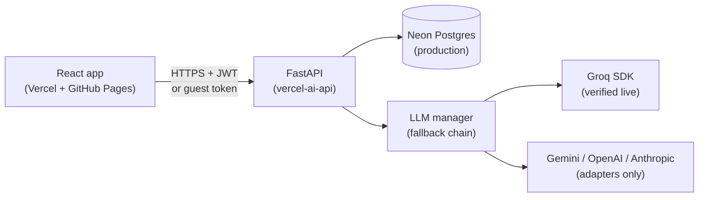

# CodeMentor AI — Project Overview

Comprehensive technical and product reference for the existing repository.
Source of truth is the code itself; each claim is marked
**VERIFIED** (executed), **IMPLEMENTED** (in code + tests, awaiting live proof),
**PARTIAL**, **PLANNED**, or **BLOCKED**. No secrets appear in this document.

Related docs: `docs/production-readiness.md` (audit),
`docs/product-evolution-proposal.md` (roadmap),
`docs/deployment-checklist.md` (account steps).

## 1. Project overview

**Purpose.** CodeMentor AI is a Socratic programming mentor: instead of
handing out fixed code, it diagnoses bugs internally and teaches through one
guiding question at a time, a 3-hint budget, misconception tracking, and an
explanation check that closes a session only when the student explains the fix.

**Users.** Beginner-to-intermediate developers learning to debug, plus guests
evaluating the product (1 free session, no account).

**Major capabilities (all VERIFIED locally).** Auth + guest mode; mentor
sessions with goals (debug/review/explain); JSON + SSE-streamed turns; hints;
explanation scoring; misconceptions, skills, streaks, badges; dashboard,
history with replay/resume, doc simplifier, learning paths; projects with
milestones/tasks and AI briefs; curated doc links; PWA shell.

**Direction.** Grow into Learn/Build/Improve modes on the same architecture
(see `docs/product-evolution-proposal.md`). Implemented: core mentor +
projects + references. Planned: practice sessions, retrieval evaluation.

## 2. Architecture

- **Frontend** (`frontend/`, React 18 + TS + Vite + Tailwind v4, HashRouter):
  static build on GitHub Pages under `/codementor-ai/`. Talks to the API via
  `VITE_API_BASE_URL` (public config).
- **Backend** (`backend/app/`, FastAPI + SQLAlchemy 2, sync): JWT auth, guest
  tokens, Socratic endpoints, LLM manager, SQLite locally / Postgres via
  `DATABASE_URL`.
- **AI provider manager** (`app/llm/`): Groq (official SDK, VERIFIED live) →
  Gemini → OpenAI → Anthropic fallback; a provider is tried only if its key
  is configured. Structured JSON parsed + Pydantic-validated; failures map to
  502/503, never leaking keys.
- **Database**: 15 tables (users, sessions, messages, hints, misconceptions,
  skills, skill_progress, learning_paths, path_items, badges, user_badges,
  daily_activity, doc_simplifications, projects, milestones, project_tasks);
  8 Alembic revisions; migrations run automatically in the Vercel build step.
- **Progress tracking**: activity rows → streaks; misconceptions → skills;
  solve events → badges; all computed from stored rows, never fabricated.
- **PWA**: manifest + icons + service worker in `dist/`; API traffic is
  `NetworkOnly`.
- **Hosting**: Frontend live on Vercel (`https://codementor-ai.vercel.app`)
  with a GitHub Pages mirror; backend live on Vercel
  (`https://codementor-ai-api.vercel.app`); Neon Postgres in production.



## 3. Frontend guide

**Pages/routes** (`frontend/src/pages/`, lazy-loaded in `main.tsx`):
`/` Landing, `/app` Workspace, `/projects` Projects, `/dashboard` Dashboard,
`/history` History + replay, `/docs` Simplifier + references, `/login`,
`/signup`, `/profile` (Profile & settings: display name, email + verification
state + resend, theme, email notification preferences, preferred language /
experience level / learning goal, change password, delete account),
`/verify`, `/forgot`, `/reset`, `/privacy`, `/terms`. Unknown routes redirect
home.

**Components** (`frontend/src/components/`): Navbar (7 links, hamburger below
1024px), Footer (4 columns), Logo (inline SVG), AnchorLink (hash-safe),
CodeEditor (lazy CodeMirror), Reveal/Counter/Faq, Toast, TypingDots/skeletons.
Loading indicators: `thinking-orbs@0.3.2` (MIT, canvas, `ThinkingOrb`
`working` size 32 in the mentor thinking row while a request is in flight,
`composing` size 20 on the brief button; `theme="auto"` follows the app
`data-theme`; only states with a genuinely active operation are used —
`solving`/`searching`/`connecting`/`listening` have no separately observable
frontend step, so they are not shown). Landing hero carries one pure-CSS
aurora wash (violet/indigo/cyan, reduced-motion static, pointer-transparent).

**State.** TanStack Query for server data (5-min stale, no refetch on focus);
local `useState` for chat/drafts; `localStorage` for JWT (`cm_token`), guest
token (`cm_guest`), theme (`cm-theme`). Auth context restores the session via
`GET /api/auth/me`. API base URL: `VITE_API_BASE_URL` (canonical,
`VITE_API_URL` legacy fallback); local `vite dev` defaults to
`http://127.0.0.1:8000`, while production builds fail fast with an explicit
"backend not configured" error instead of silently calling localhost
(`API_MISCONFIGURED` banner + guarded session start).

**Design system** (`index.css`): near-black `#0A0A0F`, surface `#12121A`,
violet `#7C5CFF`, thin borders; Inter UI, Times New Roman display/serif body,
JetBrains Mono code; dark default + light theme; lucide icons, no emojis;
reduced-motion support.

## 4. Backend guide

**Entry** (`app/main.py::create_app`): builds engine/session factory/LLM
manager/rate limiter, validates production config (refuses dev JWT secret and
non-Postgres DB), mounts CORS (explicit origins), RequestID middleware,
exception handlers mapping everything to `{detail, code}`.

**Routers** (`app/routers/`): `auth` (signup/login/me/update/delete),
`mentor` (sessions, turns, SSE stream, hints, explain), `meta`
(health/ready/snippets/languages/resources), `progress` (dashboard/skills/
learning-path), `docs` (simplify/history), `projects` (+milestones/tasks/
brief/next).

**Services** (`app/services/`): `mentor.py` (history window 20, JSON
extraction), `orchestration.py` (deterministic intent, previous-question
surfacing, `is_repeat` ≥0.82 + containment, one-retry nudge, code snapshots,
`turn_context_block`), `knowledge.py` (18 curated cards, token-overlap
`retrieve(top_k=2)`, `format_references` UNTRUSTED blocks, `citations`
from retrieval only), `languages.py` (authoritative registry), `detect.py`
(regex scoring), `snippets.py` (10 samples), `progress.py`
(activity/streak/badges/skills).

**Middleware/deps**: CORS allow-list, sliding-window per-IP rate limits
(signup/login 10-min, mentor 30/min), `get_db`/`get_current_user`/
`get_optional_user`/guest-token dependencies.

**Validation**: Pydantic v2 everywhere — passwords ≥8 chars, code ≤8000,
messages ≤4000, doc text ≤4000, titles ≤200, statuses as Literals, language
 Literals, ownership checks on every nested resource.

**Auth**: bcrypt hashes, PyJWT HS256, 7-day expiry, 401 on missing/invalid/
expired tokens, password re-check on delete (cascades everything).

**Logging/errors**: sanitized `LLMError` (keys redacted), generic 502/503 to
clients, `X-Request-ID` echo, unhandled exceptions logged server-side only.

## 5. API reference

Base: backend origin. Auth: `Authorization: Bearer <jwt>` or
`X-Guest-Token` where noted. All IMPLEMENTED (pytest-covered) except where
marked.

| Method + path | Auth | Purpose | Location |
|---|---|---|---|
| GET `/health` | no | liveness + provider names | `routers/meta.py` |
| GET `/ready` | no | DB `SELECT 1` + provider names (no AI call) | `routers/meta.py` |
| GET `/api/snippets[?language=]` | no | 10 buggy samples | `routers/meta.py` |
| GET `/api/languages` | no | registry metadata | `routers/meta.py` |
| GET `/api/resources[?language=]` | no | 12 curated doc links | `routers/meta.py` |
| POST `/api/auth/signup` | no | create account (409 dup) + welcome notification | `routers/auth.py` |
| POST `/api/auth/login` | no | JWT (401 wrong) | `routers/auth.py` |
| POST `/api/auth/resend-verification` | JWT | verify link, 3/hour cap | `routers/auth.py` |
| POST `/api/auth/verify-email` | no | single-use 24h token → verified | `routers/auth.py` |
| POST `/api/auth/forgot-password` | no | generic reply + link if account exists | `routers/auth.py` |
| POST `/api/auth/reset-password` | no | new password + revoke all sessions | `routers/auth.py` |
| GET/PATCH/DELETE `/api/auth/me` | JWT | profile / preferences (display name, theme, email prefs, preferred language, experience level, learning goal) / delete-all | `routers/auth.py` |
| POST `/api/auth/change-password` | JWT + current password | rotate password; revokes other sessions; fresh token | `routers/auth.py` |
| POST `/api/sessions` | optional | create (guests: 1 free; `language:auto` detected; `mode: practice\|mycode`; blank code → 422) | `routers/mentor.py` |
| GET `/api/sessions` | JWT/guest | history list | `routers/mentor.py` |
| GET `/api/sessions/{id}` | owner | full replay | `routers/mentor.py` |
| POST `.../{id}/messages` | owner | Socratic turn (JSON; optional `code` snapshot; `sources[]`) | `routers/mentor.py` |
| POST `.../{id}/messages/stream` | owner | SSE `provider/token/done/error` (`code` snapshot; `done` carries `sources[]`) | `routers/mentor.py` |
| POST `.../{id}/hints` | owner | 1 of 3 hints (403 at 0; optional `code`) | `routers/mentor.py` |
| POST `.../{id}/explain` | owner | judge explanation; solves (optional `code`) | `routers/mentor.py` |
| GET `/api/dashboard` | JWT | real stats/weak-spots/badges | `routers/progress.py` |
| GET `/api/skills` | JWT | measured encounters/scores | `routers/progress.py` |
| GET `/api/learning-path` | JWT | active path or `null` | `routers/progress.py` |
| POST `/api/learning-path/regenerate` | JWT | rebuild from weak spots | `routers/progress.py` |
| PATCH `/api/learning-path/items/{id}` | JWT | todo/doing/done | `routers/progress.py` |
| POST `/api/docs/simplify` | JWT | explanation+example+question (+`sources[]` from approved retrieval) | `routers/docs.py` |
| GET `/api/docs/history` | JWT | past simplifications | `routers/docs.py` |
| POST `/api/projects` | JWT | create (+language check) | `routers/projects.py` |
| GET `/api/projects` | JWT | list with counts | `routers/projects.py` |
| GET/PATCH `/api/projects/{id}` | JWT owner | detail / update | `routers/projects.py` |
| POST `/api/projects/{id}/brief` | JWT owner | AI brief → stores milestones/tasks | `routers/projects.py` |
| POST `/api/projects/{id}/milestones` | JWT owner | add | `routers/projects.py` |
| PATCH `/api/projects/milestones/{mid}` | JWT owner | update | `routers/projects.py` |
| POST `/api/projects/milestones/{mid}/tasks` | JWT owner | add | `routers/projects.py` |
| PATCH `/api/projects/tasks/{tid}` | JWT owner | update | `routers/projects.py` |
| GET `/api/notifications` | JWT | Own notifications, newest first | `routers/notifications.py` |
| GET `/api/notifications/unread-count` | JWT | Unread badge count | `routers/notifications.py` |
| PATCH `/api/notifications/{id}/read` | JWT owner | Mark one read | `routers/notifications.py` |
| POST `/api/notifications/read-all` | JWT | Mark all read | `routers/notifications.py` |
| GET `/api/memory` | JWT | Weak spots + misconception records | `routers/memory.py` |
| DELETE `/api/memory/misconceptions/{id}` | JWT owner | Delete one record | `routers/memory.py` |
| GET `/api/projects/{id}/next` | JWT owner | first open task + guidance | `routers/projects.py` |

Proposed (PLANNED, not implemented): vector-search retrieval,
LangGraph/agents, new providers, code execution (Judge0), GitHub repo
integration. Implemented instead: practice/mycode session modes (no
execution), lexical approved-reference retrieval (`docs/RESOURCE_RETRIEVAL.md`),
explicit-Python orchestration (`docs/MENTOR_ORCHESTRATION.md`, LangGraph
evaluated and not needed).

## 6. AI mentor lifecycle

1. UI sends code + language/goal/mode (+optional `project_id`) → `POST /api/sessions`.
2. Turn: user message stored → `_prepare_turn()` (rule-based intent, previous
   question surfaced, code snapshot applied when newer, approved references
   retrieved, context block built) → system prompt assembled
   (goal preamble + Socratic rules incl. greeting rule + language guidance +
   full current code block + references + turn notes) → `LLMManager.complete` tries configured providers in order.
3. Model must return strict JSON (`reply`, `understanding_score`,
   `misconception?`, `evaluation?`, `next_topics`); parse/validation failure → HTTP 502.
   Non-streaming retries once on detected repeat; streaming relies on
   prompt-level do-not-repeat (tokens already sent).
4. Streaming variant streams prose tokens, then runs a scoring call and emits
   a final `done` event with the same structured payload + `sources[]`.
5. Assistant reply, score, misconception row, skill bump, activity row,
   `meta.evaluation`, persisted `meta.sources`, and measured token usage persist in one transaction;
   hints/explain follow the same path with their own prompts. Solved sessions become read-only (409).

## 7. Programming languages

| Language | Detect | Highlight | Snippet | Prompt note | Docs links | Linters | Execution |
|---|---|---|---|---|---|---|---|
| Python/JS/TS/Java/C++/Go/SQL | yes | full | yes | yes | yes | no | no |
| C, Rust | yes | full (C via C++ grammar) | yes | yes | yes | no | no |
| C# | yes | **fallback (Java grammar)** | yes | yes (+note) | yes | no | no |
| C/Rust/HTML-CSS | no | no | no | no | no | no | no |

Gaps (honest): regex heuristics can tie on ambiguous input (returns
`unknown`, UI asks explicitly); C# colors are approximate; no language runs
code; no per-language test tooling. Detector lives in the registry; the
frontend mirror is best-effort, backend authoritative.

## 8. Database

SQLite (`backend/codementor.db`) for local dev; Postgres via `DATABASE_URL`
in production, refused otherwise at boot. SQLAlchemy 2, portable string-UUID
keys. 15 tables (§2), FKs + indexes + unique constraints; cascades on user
delete. Migrations: `64bf…` (schema+seeds), `f4c926f` (path source),
`8f967aef` (session goal), `3445aae6` (projects/milestones/tasks +
sessions.project_id, batch-mode FK for SQLite), `567d88…` (email
verification/tokens), `ef19ab…` (notifications/preferences),
`dc55a8…` (sessions.mode, default `practice`), `3a1c9d47b802` (user
learning preferences: `preferred_language`, `experience_level`,
`learning_goal` with safe `""` defaults). Fresh DBs migrate cleanly
(proven by the test suite, which upgrades scratch DBs; production Neon is
migrated and live — verified 2026-10-16/17 by a real profile PATCH round-trip).
Single head: `3a1c9d47b802`.

## 9. Projects and milestones

Brief (objective/requirements/architecture) generated from a description and
stored with created milestones/tasks; statuses cycle todo→doing→done;
`/next` returns the first open task or `{done:true}`; sessions link via
`project_id` (ownership-checked; guests rejected). Limits: 5 milestones ×
5 tasks per brief; no project delete endpoint yet (account delete cascades);
no cross-project task moves.

## 10. AI providers

Manager order: `LLM_PROVIDER` then `LLM_FALLBACKS` (`groq,gemini,openai,
anthropic`); only keyed providers are tried; any failure tries the next;
all-fail → 503. Defaults: `openai/gpt-oss-20b`, `gemini-2.0-flash`,
`gpt-4o-mini`, `claude-3-5-haiku-20241022` (override via `LLM_MODEL` /
`<NAME>_MODEL`). Timeouts 45s, `max_tokens` 700, no retries inside a
provider (one attempt, then fallback). Usage recorded only when reported.
**Tested live: Groq only** (`openai/gpt-oss-20b`, verified 2026-10-16 with
the rotated key, incl. partial-answer, greeting, code-update, streaming).
Adapters for the other three are code-complete
with parser unit tests but have never made a real call.
**Nemotron Ultra decision (2026-10-16, verified): not available through
Groq** — live model list has 11 entries, none Nemotron; `openai/gpt-oss-20b`
stays the configured default. Serving Nemotron Ultra would need a new
provider (e.g. NVIDIA NIM endpoint + key), which is not implemented —
say the word if you want it and can supply the key.

## 11. Environment configuration

Backend (`backend/.env`, git-ignored; see `backend/.env.example`):
`ENVIRONMENT`, `DATABASE_URL` (secret in prod), `JWT_SECRET` (secret, ≥32 in
prod), `ALLOWED_ORIGINS`, `LLM_PROVIDER`, `LLM_FALLBACKS`, `LLM_MODEL`,
`LLM_API_KEY`, `GROQ/GEMINI/OPENAI/ANTHROPIC_API_KEY` (secrets),
`GROQ/GEMINI/OPENAI/ANTHROPIC_MODEL`, `LLM_TIMEOUT_SECONDS`,
`LLM_MAX_TOKENS`, `RATE_LIMIT_SIGNUP/LOGIN/MENTOR`, `MAX_HINTS_PER_SESSION`,
`HISTORY_WINDOW`, `MAX_SESSION_MESSAGES`, `EMAIL_PROVIDER`
(`console`|smtp), `EMAIL_SENDER`, `EMAIL_SMTP_HOST/PORT/USER/PASSWORD`
(secrets, smtp only), `FRONTEND_URL` (public, used in email links).
Frontend (`frontend/.env`,
optional): `VITE_API_BASE_URL` — **public** config, also settable as a repo
Variable for Pages builds.

## 12. Deployment

- **Frontend**: LIVE — Vercel project `codementor-ai`
  (`https://codementor-ai.vercel.app`), git-connected to `astroelaa/codementor-ai`
  branch `main`, Root Directory `frontend`. GitHub Pages
  (`https://astroelaa.github.io/codementor-ai/`) stays as a public mirror
  built by `.github/workflows/pages.yml` with the repo variable
  `VITE_API_BASE_URL`.
- **Backend**: LIVE — Vercel project `codementor-ai-api`
  (`https://codementor-ai-api.vercel.app`), Root Directory `backend`,
  entry `app/main.py`, 300s timeout, `iad1` region, `.python-version` pins
  3.13. The build step runs the guarded migration runner
  (`backend/scripts/migrate.py`): pending migrations apply inside the build
  (where `DATABASE_URL` exists as an env var, never exposed), and redeploys
  are no-ops when the schema is current. Alternatives documented in the repo:
  `render.yaml` Blueprint and `backend/Dockerfile` for HF Spaces — neither is
  in production.
- **DB**: Neon free Postgres; URL pinned to `postgresql+psycopg2://`
  (`app.database.normalize_database_url`) and stored only as a Vercel secret.
- **CORS**: exact allow-list (`codementor-ai.vercel.app`,
  `astroelaa.github.io`, plus local dev ports).
- **CI (`.github/workflows/ci.yml`)**: backend pytest + frontend build — green.

## 13. Testing

- Backend: `python -m pytest -q` from `backend/` — **144 passed** (auth
  incl. email verification/resend caps + profile preferences +
  POST /api/auth/change-password, guest caps, mentor/stream/hints/explain,
  ownership isolation, dashboard, docs, projects, detection, prompts, usage
  extractors, ops incl. default Pages CORS origin, no-leak,
  orchestration/intent/anti-repeat/code-snapshots/citations/modes — 29 in
  `test_orchestration.py`). Scratch migrated SQLite DBs; fake LLM (no
  network). Latest full run green (2026-10-17).
- Frontend: `npm run build` (`tsc --noEmit` + Vite + PWA) — **exit 0**.
  No unit-test runner; browser-verified flows: signup/login, diagnose,
  streaming, hints, solve, resume-after-refresh, project create, dashboard
  data, history replay, theme toggle, profile editing — zero console errors.
- Production end-to-end (2026-10-17, live API): disposable account signup
  201 → resend-verification 200 → PATCH preferences 200 and persisted →
  invalid language 422 → change-password 200 (wrong current password 401,
  old token 401 afterward, login with new password 200) → delete with wrong
  password 401 → delete with correct password 204 → account gone
  (login 401). A previous live round proved verification email delivery to
  a real inbox (user-confirmed).

## 14. Security

Bcrypt passwords; HS256 JWT 7-day expiry; Bearer or guest-token auth;
per-resource ownership checks (sessions, projects, milestones, tasks, paths,
docs); guest project-linking rejected; rate limits on signup/login/AI writes;
size caps on every free-text field; CORS allow-list (no `*`); keys only in
server env/headers, redacted from errors, absent from git (scanned per
commit); `X-Request-ID` for failure correlation. Limitations: JWT in
`localStorage` (XSS trade-off for static hosting; short-ish expiry, logout
clears); in-memory rate limiter (single-instance correct); no WAF/bot
protection beyond provider edges.

## 15. PWA

`manifest.webmanifest` (CodeMentor AI, standalone, scope/start
`/codementor-ai/`), generated 192/512/maskable icons, `sw.js` via
vite-plugin-pwa (`prompt` updates with reload banner; offline-ready toast).
Workbox precaches the shell; `/api/*` is `NetworkOnly` — no tokens or
conversations cached; fonts cached 30 days. VERIFIED: manifest/SW/icons
served, SW registered with correct scope, zero errors. NOT TESTED: real
airplane-mode install/update flow (needs a device). AI mentoring honestly
requires a connection (stated in UI).

## 16. Current blockers and risks

- Old Groq key (exposed in chat during early sessions): production already
  uses the rotated key; deletion of the old key on the Groq dashboard is a
  user action.
- `codementor-ai.vercel.app` is currently a deployment alias, not a project
  domain: after each push the frontend is served at the newest deployment
  automatically, but the canonical URL needs either a one-time dashboard
  attach or a re-alias step. Documented in
  `docs/deployment-checklist.md`.
- Groq model IDs rot without notice (caused one 404 already); re-check on
  any provider 4xx. No fallback provider live-tested yet.
- Free tiers sleep (cold starts) and cap usage; rate limits are per-process.
- `let mut`-style detector collisions are fixed case-by-case, not solved
  generally (regex heuristics, documented).

## 17. Roadmap

Priorities: language registry extras (done: C/Rust) → mentor depth (done:
guidance + greeting rule + evaluation + anti-repeat) → projects (done) →
references (done: 18-card approved corpus with lexical retrieval, not vector
search). Still evaluation-only: vector search, LangGraph/agents (evaluated,
not needed — see `docs/MENTOR_ORCHESTRATION.md`), new providers, code
execution (Judge0), GitHub repo integration. Do not treat any of these as implemented.
No code is executed anywhere: language registry `execution` is `"none"` for
every language; the UI never claims otherwise.

## 18. New developer setup

```bash
# backend
cd backend && python -m venv .venv && .venv\Scripts\activate
pip install -r requirements.txt
copy .env.example .env   # then set GROQ_API_KEY inside backend/.env
alembic upgrade head
uvicorn app.main:app --reload --port 8000   # docs at /docs, health at /health
python -m pytest -q                          # 144 tests, fake LLM, no network
# frontend (new terminal)
cd frontend && npm install && npm run dev    # http://127.0.0.1:5173/
npm run build                                # typecheck + production bundle
```

Common errors: port in use (stop the old process); `alembic ... not up to
date` (run `alembic upgrade head` on the dev DB after pulling migrations);
`POST /api/sessions → 503` (no provider key configured); guest 403 (device
already used its free session — sign up).
